<!--
  GENERATED by scripts/gen_profile.py. Do not edit by hand.
  To change what's shown, edit profile.config.json and run:
      python3 scripts/gen_profile.py
  (the "Refresh profile" GitHub Action also does this daily with fresh stats/posts)
-->

 
 
 
 
 
 

 

Design adapted from <a href="https://github.com/basteez/basteez">basteez/basteez</a>.

